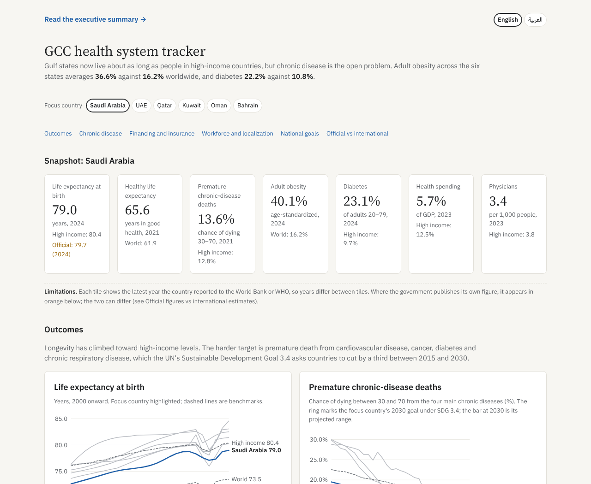
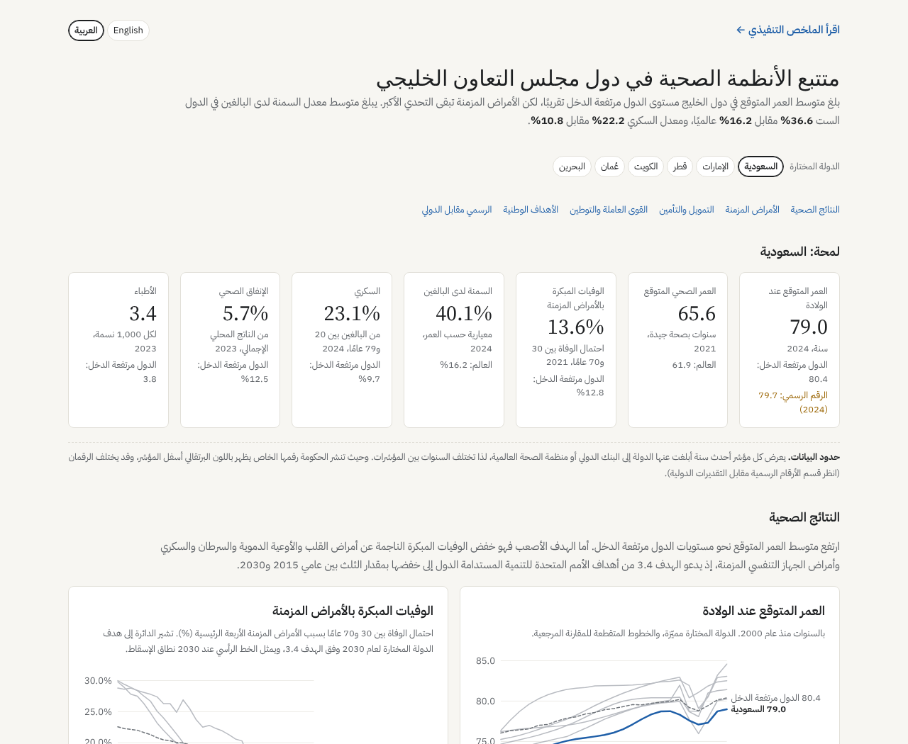

# GCC Health System Tracker

**Live site: [hamzasaleh10.github.io/gcc-health-tracker](https://hamzasaleh10.github.io/gcc-health-tracker/)** · [العربية](https://hamzasaleh10.github.io/gcc-health-tracker/?lang=ar)

A bilingual (English/Arabic) dashboard that benchmarks the six Gulf Cooperation Council health systems (Saudi Arabia, the UAE, Qatar, Kuwait, Oman and Bahrain) against high-income countries and the world. It covers health outcomes, chronic disease risk, financing and insurance, workforce and localization, and each country's national goals, and sets official national figures beside international estimates. International data refreshes automatically every month; national figures from government sources are reviewed yearly. Every panel states its limitations.



## What it shows

| Section | Question it answers | Key finding (latest data) |
| --- | --- | --- |
| National goals | How are countries doing against their own targets? | Saudi Arabia met its 2025 nursing target and is close on life expectancy; Oman has passed its 2030 healthy life expectancy target on WHO's latest data, partly a post-pandemic rebound. |
| Outcomes | Are Gulf states on track for the 2030 goal on premature chronic-disease deaths (UN SDG 3.4)? | On a 2015–2021 trend with an 80% range: Qatar and Oman on track; Kuwait uncertain; Saudi Arabia, the UAE and Bahrain off track. |
| Chronic disease risk | How large is the obesity and diabetes burden? | Adult obesity averages 36.6% across the GCC against 16.2% worldwide; diabetes 22.2% against 10.8%. |
| Financing and insurance | Who pays for health care, and how is that changing? | GCC states spend 2.5–5.7% of GDP on health against 12.5% in high-income countries; governments fund 59–89%. All six are moving expatriates, and increasingly citizens, onto insurance. |
| Workforce and localization | Are there enough clinicians, and how many are citizens? | Physician supply is near high-income levels in several states; nurses and beds lag. Citizens are 9–43% of physicians but under 5% of nurses in the UAE and Kuwait. |
| Official vs international | Where do national and international figures disagree? | In both directions: Saudi official life expectancy is above the World Bank's, Oman's and Bahrain's are below; Bahrain's own workforce figures are about three times the World Bank's. |

An [executive summary](https://hamzasaleh10.github.io/gcc-health-tracker/summary.html) ([العربية](https://hamzasaleh10.github.io/gcc-health-tracker/summary.html?lang=ar)) sets out the key findings, eight metrics for strategic leadership and six strategic insights.

Sections open as tabs, and picking a focus country updates every one. Views can be shared by link: `?lang=ar&focus=QAT&tab=workforce` opens the Arabic workforce tab focused on Qatar.

## How it works

```
World Bank API ─┐
                ├─> scripts/refresh.py ──> data/*.json ──> index.html (D3.js) ──> GitHub Pages
WHO Global     ─┘    (fetch, validate)       (committed)     (calculations
Health Observatory                                            run in browser)
        ▲
        └── GitHub Actions, 2nd of every month (.github/workflows/refresh-data.yml)
```

- **National data.** `data/national.json` holds official figures, goals, insurance milestones and workforce localization from each government's statistics office or health ministry, with a source for every entry. It is updated by hand once a year, because most national sources are PDF reports or sites that block automated access.
- **Pipeline.** `scripts/refresh.py` pulls 14 World Bank indicators, WHO adult-obesity and WHO healthy life expectancy estimates for the six GCC states plus benchmarks, validates row counts, country and indicator coverage and value types, and only then writes the JSON files. A failed source or a suspicious result stops the run without touching the published data.
- **Automation.** A scheduled GitHub Actions workflow runs the pipeline monthly and commits the data only when it changed. GitHub Pages republishes the site on each commit.
- **Front end.** A single static page with D3.js charts. Derived metrics (latest values, GCC averages, SDG 3.4 projections, spending tables) are computed in the browser from the raw data, so every figure traces back to a source row.
- **Bilingual.** Full English and Arabic versions with right-to-left layout, translated labels, tables and chart annotations.

Run it locally:

```bash
pip install -r requirements.txt
python scripts/refresh.py data      # refresh the data
python -m http.server 8000          # then open http://localhost:8000
```

## Data sources

| Data | Source |
| --- | --- |
| Life expectancy, infant mortality, population, age structure | [World Bank World Development Indicators](https://data.worldbank.org/indicator) (UN Population Division) |
| Premature chronic-disease mortality (ages 30–70), road traffic deaths | World Bank WDI, from WHO Global Health Estimates |
| Diabetes prevalence (ages 20–79) | World Bank WDI, from the International Diabetes Federation |
| Health spending, government and out-of-pocket shares | World Bank WDI, from the WHO Global Health Expenditure Database |
| Physicians, nurses and midwives, hospital beds | World Bank WDI, from WHO and OECD |
| Adult obesity (age-standardized) | [WHO Global Health Observatory](https://www.who.int/data/gho/data/indicators/indicator-details/GHO/prevalence-of-obesity-among-adults-bmi--30-(age-standardized-estimate)-(-)) (API) |
| Healthy life expectancy | [WHO Global Health Observatory](https://www.who.int/data/gho/data/indicators/indicator-details/GHO/gho-ghe-hale-healthy-life-expectancy-at-birth) (API) |
| Saudi official figures and targets | [Health Sector Transformation Program reports 2023 and 2025](https://www.vision2030.gov.sa/media/y0pc5yc3/health-sector-transformation-report-2025-en.pdf); [GASTAT workforce statistics 2023](https://www.stats.gov.sa/documents/d/guest/healthcare-establishments-and-workforce-statistics-2023en-pdf) |
| UAE workforce by citizenship | [UAE.Stat (Federal Competitiveness and Statistics Centre)](https://uaestat.fcsc.gov.ae/) |
| Qatar insurance, beds, workforce density | [Qatar Open Data Portal](https://www.data.gov.qa/) |
| Kuwait workforce by nationality | [Central Statistical Bureau, Annual Statistical Abstract 2023–2024](https://www.csb.gov.kw/Pages/Statistics?ID=18&ParentCatID=2) |
| Oman workforce, life expectancy, 2040 needs | [NCSI Health Statistics, 2025 data](https://api.ncsi.gov.om/uploads/pdfs/health_statistics_2026_1788850586.pdf) |
| Bahrain life expectancy, workforce | [Ministry of Health Annual Health Statistics 2021–2022](https://www.moh.gov.bh/Content/Upload/File/638728900890233427-Annual-Health-Statistic-2021-2022--Report_en.pdf) |
| Goals and insurance milestones | Government strategies and announcements, cited row by row in `data/national.json` |

## Methods and limitations

- Each figure is the latest year a country reported, so years differ across countries and indicators.
- SDG 3.4 goal = each country's 2015 rate of premature chronic-disease mortality cut by one third. A least-squares trend on 2015–2021 projects 2030 with an 80% prediction interval: on track if the whole range reaches the goal, off track if none of it does, uncertain otherwise. It ignores ageing and policy change, and the 2021 figures may still carry pandemic-era deaths.
- Every panel on the site carries its own limitations note.
- The World Bank's workforce figures for Bahrain appear incomplete against the Ministry of Health's statistics; both are shown.
- No nationality split of the health workforce was found for Qatar or Bahrain.
- GCC averages are simple means of the six states, not population-weighted.
- Figures cover all residents, nationals and expatriates combined.
- Official national figures and WHO modelled estimates use different methods and are not directly comparable; the dashboard shows both deliberately.

## About

Built by Hamza Saleh, MPH, as a portfolio project on public data. It is not affiliated with any government or organization named here.


